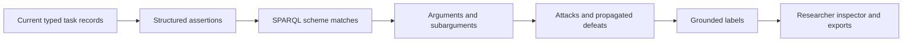

# Graph argumentation in shadow mode

New sessions carry `argumentation_configuration` and evaluation snapshots carry
`graph_argumentation`. With RDFLib installed, the engine discovers arguments by
querying typed task records and structured assertions. The existing policy,
language evidence package and participant messages continue to use the original
candidate mechanism. Graph results are visible to the researcher in the inspector
and JSON/RDF exports; they do not select live interventions.

This is a small, explicit structured argumentation implementation. It is inspired
by strict/defeasible rules and attacks on premises, conclusions and rule applications
in [ASPIC+](https://webspace.science.uu.nl/~prakk101/pubs/ASPICtutorial.pdf), but is
not a complete ASPIC+ implementation or a general classical-logic reasoner.

## Data and execution

The shared extension uses `arg: <https://example.org/socratic/argumentation/>`.
Its vocabulary, shapes and shared schemes are under
[`socratic_prototype/argumentation/`](../socratic_prototype/argumentation/).
MAB and TBS provide separate scheme packs through optional task hooks. The existing
core/task/domain ontology files and their frozen descriptors are unchanged.



For each evaluation snapshot the reasoner builds a local graph from the actual
task RDF projection. It wraps relevant numerical records as assertions, preserving
their sources and kinds. MAB contributes observed-choice counts, sampled-arm count
and remaining decisions as typed history summaries. Eligible model hypotheses
become provisional model premises. Disagreement and accepted strategy quotations
retain participant attribution and source event identifiers.

An assertion has a structured proposition: subject, predicate, typed object,
positive/negative polarity and current-state scope. The assertion also has a kind,
epistemic statuses and source. Propositions are not asserted as unqualified facts
about the participant. A recorded model estimate or quoted report stays an estimate
or report, including when its premise argument is labelled accepted.

Rules operate on assertion indexes that mirror those propositions. SHACL checks
that the indexes equal the canonical proposition values. Every match must return
actual assertion identifiers from the same current state. Queries are SELECT-only,
locally authored and versioned; network SERVICE queries and updates are rejected.
Participant text and LLM output cannot become executable queries or rules.

Each match creates an argument with a conclusion assertion, premise identifiers,
subarguments, scheme, inference kind and explicit priority. Rules run in a bounded
forward sequence so a derived conclusion can support another argument. Content-derived
identifiers, sorted matches and fixed rule order make replay deterministic. Circular
proofs are excluded. Independent proofs of the same proposition remain distinct.

All input assertions participate in discovery. Stored reports retain complete
premises/conclusions for every constructed proof, plus attributed reports. Unrelated
numerical records remain in the canonical task snapshots and task RDF, avoiding
another copy of every quantity in every reasoning report.

## Initial schemes

| Pack | Discovered arguments |
| --- | --- |
| Shared | An eligible provisional model interpretation warrants considering a challenge; explicit participant contestation undercuts that model-to-challenge inference pending verification |
| MAB | At least six observed choices leave some arms unsampled; this coverage gap warrants discussing exploration; a horizon of two or fewer decisions supports an objection; sampled change estimates can warrant checking for change |
| TBS | Compare current expected gains; compare current final-choice attainment probabilities; join the two comparisons to detect differing rankings; consider asking which objective guides the choice |

MAB's coverage argument is strict arithmetic about observed counts. Its exploration
argument is defeasible: limited coverage does not establish that further exploration
is worthwhile. The short-horizon objection has its own count premise. With the
default equal priorities, these contrary arguments remain undecided rather than
one being declared the winner.

For the synthetic TBS final-choice example, safe has EV 108 versus risky's 91,
while risky has attainment probability 0.35 versus safe's zero. Separate strict
comparisons support a third argument that the criteria rank the options differently.
A defeasible argument then supports clarifying the objective. These compatible
comparisons do not attack one another and do not prove which option the participant
ought to choose. No current scheme claims knowledge of the participant's objective.

Strict inference preserves uncertainty: a strict consequence of estimated premises
remains inferred. Known conclusions require a strict rule and exclusively known
premises. The numerical models and Bayesian probabilities are not recalculated by
the argument evaluator.

## Objections, defeat and labels

The initial conflict language requires an explicit opposite polarity over the same
subject, predicate, typed object and state. Missing data is not negation, different
states are not contradictions, and different comparison criteria are not contraries.
Additional domain-specific contraries would need an explicit extension.

- **Undermining** targets a contrary ordinary premise: an assumption, report or estimate.
- **Rebutting** targets the contrary conclusion of a defeasible rule application.
- **Undercutting** targets applicability of a named defeasible scheme to the same subject.

Rebuttal and undermining succeed when the attacker is not less preferred than the
targeted argument. Undercutting is independent of these priorities. The initial packs
use equal priorities; Bayesian confidence and intervention usefulness are not argument
priorities. A successful attack also defeats proofs containing the targeted subargument.

Grounded labelling iteratively accepts arguments whose defeaters are rejected and
rejects arguments with an accepted defeater; unresolved cycles remain undecided.
Labels express justification under this finite rule system, not truth or measured
intervention benefit. Inconsistent accepted strict conclusions are rejected as a
rule/premise integrity error, rather than being presented as jointly justified.
The implementation does not supply arbitrary logical closure, automatic priority
learning, preferred-extension enumeration or unrestricted argument mining. Related
issues are not automatically equated: the generic model-challenge warrant and the
exploration-cost discussion remain different conclusions unless a scheme connects them.

Critical questions are attached to rules and shown in the inspector. An unanswered
question is not a fabricated objection. No rule infers unobserved intention, neglect
or irrationality from a missing explanation. Explicit contestation undercuts the
particular model-to-challenge inference; it does not refute logged choices or revise
the Bayesian posterior. Reports and contestation follow the existing scope/expiry
rules, and later snapshots are recomputed without overwriting past analyses.
Re-analysing an earlier event uses only its event-history prefix, excluding later
feedback and researcher reviews.

## Integrity, dependencies and timing

New sessions freeze reasoner version, mode, semantics, RDFLib version, construction
limits and SHA-256 hashes of the schema, shapes and selected scheme packs. Store
ingestion and replay reject drift. Source changes require corresponding version
discipline, just as for the existing model implementations. Old sessions without
the new configuration retain their original snapshots and RDF projection.

Record validation checks links, proof acyclicity, scope, epistemic preservation and
grounded labels. With pySHACL installed, the normal candidate-event graph validation
also checks the argumentation projection; full graph validation remains available.
RDFLib is the existing optional research dependency. If absent when a session starts,
the analysis explicitly reports `unavailable`; it does not claim reasoning executed.
Install the research requirements and start a new session to enable it.

Construction is bounded to six rounds, 256 arguments, 512 assertions and 1,024
matches per snapshot. A limited construction labels all arguments undecided because
an omitted argument could defeat one already found. These are construction limits,
not a hard real-time guarantee for arbitrary custom SPARQL queries.

Shadow analysis adds backend work. The four-second preparation window and generation
deadline are unchanged; live display latency still requires a pilot. Benchmark graph
discovery separately from model calculation, SHACL, persistence, generation and browser
transport, and inspect actual exposure before any study use.

## Running and extending

```bash
.venv/bin/python -m socratic_prototype.server
.venv/bin/python -m socratic_prototype.argumentation.examples --output /tmp/argumentation_examples.json
.venv/bin/python -m unittest discover -s tests -p test_argumentation.py -v
```

Restart the server and create a new session. Open an evaluation snapshot in the
researcher inspector to see labels, rules, premises, subarguments, attacks, open
questions and the complete report. The example command creates synthetic partial
MAB/TBS sessions in a temporary database, verifies replay without generation and
writes three reasoning cases plus a local discovery-only timing sample. It neither
reads nor changes participant stores.
The checked-in [synthetic example report](argumentation_examples.json) illustrates
accepted MAB exploration arguments, undecided short-horizon objections and the TBS
comparison chain, with the frozen definitions and replay results.

A new task can provide `argumentation_documents()` returning its local scheme files
and `project_argumentation_facts(...)` for additional public-history aggregates.
Neither hook is mandatory for existing tasks. Schemes declare strict/defeasible
kind, premise variable names, conclusion subject/object bindings, polarity, priority,
reason and critical questions. Keep predicates in the task's own namespace, declare
them in its pack, and explicitly scope every query to the bound current state.
The shared loader checks that returned premises resolve to that state's assertions.
