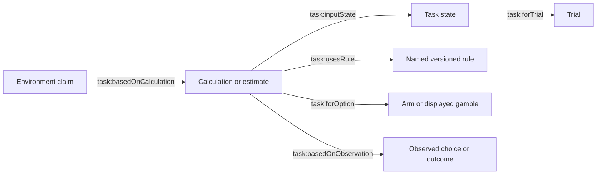

# MAB/TBS ontology walkthrough: ontology-0.2

The graph now combines the shared epistemic core, a task vocabulary and the
selected domain module. This replaces the earlier core-only audit: quantities
previously available only in JSON now have typed RDF representations. See the
[architecture and extension guide](../task_modules.md) for namespaces, module
responsibilities, versioning and compatibility.

These are synthetic backend walkthroughs, generated in a temporary store with
offline wording. They are not participant data or complete experimental sessions.
Earlier TBS messages are deliberately marked unexposed to illustrate a final-trial
intervention without a delivery cooldown. JSON remains authoritative; Python
computes the models and the graph makes their results inspectable.

## Representation

| Information | RDF representation |
| --- | --- |
| Participant, session and trial | Existing `core:` classes and identifiers |
| Claims, hypotheses, arguments and selected intervention/silence | Epistemic core, with evidence, status, alternatives and revision links |
| Task identity and public mechanics | `task:TaskDefinition` with named, versioned rules and task-specific options |
| Choice, timeout, response time and realised outcome | Separate `task:ChoiceObservation` and `task:OutcomeObservation` |
| Snapshot state | `task:TaskState`, trial, phase, version and previous state |
| Derived quantity | Calculation linked to input state, rule, option, value and unit |
| Model estimate | `task:Estimate`, inferred status, evidence and available uncertainty |
| MAB | Arm definitions, public reward magnitudes, score, reward beliefs, change estimates and learned values/parameters |
| TBS | Blocks, target goals, points, gap, remaining choices, displayed gambles, EV and final-choice attainment |

Candidate ranking, cooldown and interruption costs remain structured in JSON.
Responses and researcher reviews remain events, with attributed claims in later
snapshots; they do not yet have dedicated RDF classes. Hidden MAB probabilities,
actual shifts and future outcomes remain outside the teammate graph.



Not every calculation uses an observation directly: displayed-input arithmetic
uses its state and option; fitted estimates cite observed history.

## MAB: observation, estimate, disagreement and silence

[mab.json](mab.json) contains selected records and frozen module metadata;
[mab.ttl](mab.ttl) contains the graph for the eight-trial history.

The constructed participant repeatedly chooses `blue1` and receives zero reward.
Before choice 7, six prior observations support considering underexploration,
with provisional confidence `0.72` under the hand-written Bayesian network.
The hypothesis retains alternatives and revision conditions. The participant
disagrees: “I am keeping this option while collecting more feedback.” Subsequent
hypotheses become `contested` and link through `revises`. The posterior stays
`0.72`; disagreement changes contestation and policy scoring, not the network's
numerical result. Before choice 8, silence is explicitly attributed to cooldown
after the delivered trial-7 message.

The new graph exposes each arm's estimated reward in `reward-points`, interval,
sample count and estimated loss/zero/gain distribution. Estimates cite actual
outcome observations and the rolling Dirichlet rule. Change estimates remain
inferred. Learned values use a separate `reward/200` unit and link to the dual-rate
learning rule and parameter record; they are not observed preferences. Unsampled
arms retain prior uncertainty rather than fabricated outcomes.

Run [mab_estimates.rq](mab_estimates.rq) for the six numerical estimates before
choice 8. [mab_contested.rq](mab_contested.rq) retrieves contested revisions;
[mab_silence.rq](mab_silence.rq) retrieves the trial-8 rationale.

## TBS: EV, target attainment and the conditional multiplier

[tbs.json](tbs.json) and [tbs.ttl](tbs.ttl) describe two early wins leaving
200 points before the final choice, with target 930 and multiplier 2.3.

| Quantity | Safe | Risky |
| --- | --- | --- |
| Displayed gain | 180 | 260 |
| Displayed win probability | 0.60 | 0.35 |
| Immediate expected gain | 108 | 91 |
| Total after final-choice win | 874 | 1058 |
| Probability of attaining target on this choice | 0 | 0.35 |

The gap is 730 and one choice remains. Safe has higher immediate EV; only a risky
win reaches this target. A final loss leaves 200 points, because the multiplier
requires a final-choice win. The synthetic final risky win produces 1058 points.

These quantities now appear as numerical RDF values. The block's multiplier rule
records its final-choice and positive-gain conditions. Calculations cite rules
and evaluation state; the observed multiplied total cites the actual gain and
preceding evaluation state. Feedback states carry updated points and horizon,
without reattributing pre-choice EV/attainment to the post-choice state.

[tbs_final_calculations.rq](tbs_final_calculations.rq) queries final-choice states
with gap above 500, returning EV, win totals, attainment probabilities and multiplier
rules. [tbs_final_arguments.rq](tbs_final_arguments.rq) shows the supporting and
opposing reasons retained alongside the arithmetic.

## Validation and reproduction

[audit.json](audit.json) records declarations, graph counts, numerical predicates
and results from five queries. Both full example graphs pass their locally
selected core, task and domain SHACL shapes. Every emitted project predicate is
declared, and calculations have input states and rules. The builder also verifies
deterministic replay with zero provider calls.

Shapes check structure, types, bounds and selected applicability conditions.
Python checks public-event boundaries, order and task arithmetic. Neither check
establishes that a hypothesis is true or an intervention improves decisions.
Estimates retain their model assumptions.

From the project root:

```bash
python3 docs/ontology_examples/build_examples.py
.venv/bin/python docs/ontology_examples/check_examples.py
```

The builder overwrites only the labelled example exports in this directory.
The checker uses rdflib/pySHACL and refreshes the audit. Timestamps and calibration
source identifiers can change; illustrated quantities and named example-session
entities remain reproducible.
