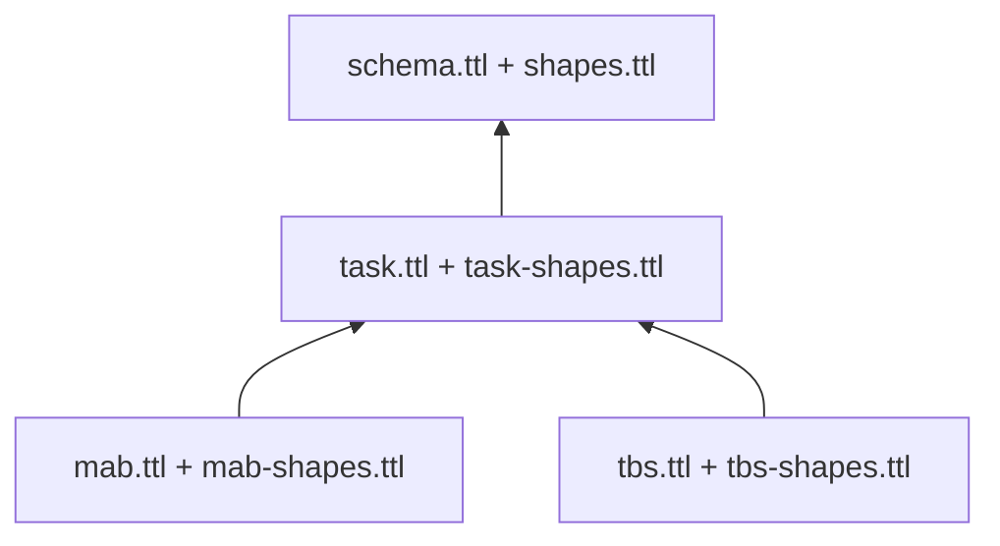

# Task modules and ontology layers

New sessions use `ontology-0.2`. Shared epistemic concepts retain their original
URIs; task mechanics have their own vocabularies and executable modules.

| Prefix | Namespace | Responsibility |
| --- | --- | --- |
| `core:` (previously `s:`) | `https://example.org/socratic/` | Participants, sessions, trials, claims, hypotheses, arguments and interventions |
| `task:` | `https://example.org/socratic/task/` | Task definitions, states, options, goals, observations, rules, calculations and estimates |
| `mab:` | `https://example.org/socratic/mab/` | Bandit arms, reward beliefs, change estimates and reward-learning models |
| `tbs:` | `https://example.org/socratic/tbs/` | Blocks, targets, displayed gambles, horizons and conditional final-win calculations |
| `data:` | `https://example.org/socratic/data/` | Session-specific state, observation and calculation identifiers |

Prefixes are abbreviations: changing `s:` to `core:` does not change identity.
These example.org namespaces identify local vocabularies; they are not published
ontology endpoints.

OWL imports follow these dependencies. The loader reads the explicit local file
list returned by the selected task module and disables remote OWL imports.
A MAB session does not load TBS classes or shapes, and vice versa. Core and
shared task vocabulary do not depend on either domain.

## Executable responsibilities

[`tasks/base.py`](../socratic_prototype/tasks/base.py) defines `TaskModule`.
[`tasks/__init__.py`](../socratic_prototype/tasks/__init__.py) provides an explicit
registry. MAB and TBS modules implement public event schemas, legal transitions,
task rules, protocol lengths, models, calibration and task-scoped hypotheses.
They supply candidate interventions with supporting/opposing reasons, allowlisted
language evidence, descriptive summaries and their own RDF projections.

The common engine owns event ordering, epistemic annotations, argument handling,
condition boundaries, policy selection, delivery cooldowns and corrections. Store,
grounding, analysis and validation delegate task operations through the registry.
`models.py` keeps the original MAB/TBS imports available as a compatibility facade.

The study's requirement for both MAB and TBS calibration is configured separately
in [`study.py`](../socratic_prototype/study.py). New tasks default to their own
calibration until a study specifies another requirement. Participant parameters
never transfer between tasks automatically.

## Meaning of the graph

JSON events and snapshots remain canonical. Python computes numeric results;
OWL declarations and SHACL constraints describe and validate their projection.
The graph is not an alternative numerical inference engine.

Each calculation links to its input state, named rule, value, unit and relevant
option. Rules identify their Python implementation and version. Estimates carry
`core:status "inferred"`, with uncertainty and observation references where the
model supplies them. Environment claims link to calculations they describe.
Choice and outcome observations have separate types and trial links.

MAB's estimated reward in points and the participant model's learned value in
`reward/200` remain distinct. Hidden reward probabilities, actual change times
and future outcomes are excluded. TBS represents current final-choice attainment
exactly; it does not infer multi-trial attainment from unknown future options.
The multiplier applies to the accumulated total only after a final-choice win.
Final feedback links its total calculation to the preceding evaluation state and
the observed positive gain. A final loss receives no multiplied-total calculation.

## Validation and frozen configurations

Python validates records, permitted information, order and task arithmetic before
commitment. With research dependencies installed, SHACL checks candidate entities
with their necessary historical context. Entry shapes use `sh:targetNode`;
nested constraints remain active on numeric literals and referenced states.
Previously validated context is not revalidated as a new incomplete entity.
`shacl_report(session)` validates the full projection for independent audits;
stored event reports identify the candidate scope. Conformance establishes
structural constraints, not scientific validity.

New sessions freeze the module ID, namespace, implementation version, ontology
versions and SHA-256 digests of all selected ontology/shape files. These enter
the configuration hash, inspector and exported JSON. The store rejects events
and replay when the current descriptor differs. Editing a definition or shape
therefore requires a new session; intentional algorithm changes also require a
new implementation/model version. Source-code hashes are not automatic, so
version discipline remains necessary.

Existing `ontology-0.1` sessions retain their original core-only export and
legacy shapes under `ontology/legacy/`. There is no automatic migration of saved
records. Legacy replay still requires matching model, policy and runtime backend.
Pre-refactor completed MAB/TBS traces were checked for identical replay and
byte-identical Turtle output.

## Adding another task

1. Implement every method in `TaskModule`, with its own ID, namespace, versions
   and positive protocol lengths. Keep the public-event allowlist and legal
   score/state transitions in that module.
2. Add a domain ontology importing `task:ontology`, plus domain shapes. Return
   explicit local dependency lists from `documents()` and use
   `describe_task(..., documents())` for the frozen descriptor.
3. Project domain states, rules and quantities using the shared RDF writer;
   declare every emitted property. Distinguish observations from estimates,
   retaining units and calculation provenance.
4. Register the module explicitly through `register_task`. HTTP parameters never
   trigger arbitrary Python imports. Configure study-specific calibration when needed.
5. Supply a task runner and browser setup integration. Current runners and setup
   choices support MAB/TBS only. `/api/tasks` exposes registered descriptors and
   protocol lengths for future interfaces.
6. Check valid/invalid transitions, numerical RDF values, shapes, evidence
   boundaries and deterministic replay.

[`test_task_modules.py`](../tests/test_task_modules.py) includes a different,
two-step synthetic task registered only during the test. It completes calibration
and an assisted session, supplies an intervention through the common policy,
exports RDF, produces a summary and replays without MAB/TBS branches.
It tests the extension contract; it is not another task in the study interface.

See the [executable ontology walkthrough](ontology_examples/README.md) for MAB/TBS
SPARQL queries. Remaining JSON-only details include candidate ranking/cooldown
quantities and full response/researcher-review event entities; those have not
been promoted into new shared ontology classes in this change.
