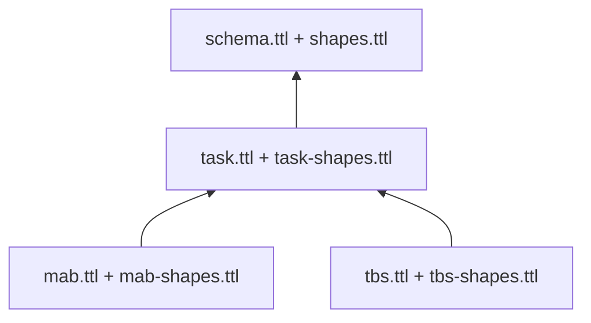

# Task modules and ontology layers

New sessions use `ontology-0.2`. Shared epistemic concepts retain their original
URIs; task mechanics have their own vocabularies and executable modules.

| Prefix | Namespace | Responsibility |
| --- | --- | --- |
| `core:` (previously `s:`) | `https://example.org/socratic/` | Participants, sessions, trials, claims, hypotheses, arguments and interventions |
| `task:` | `https://example.org/socratic/task/` | Task definitions, states, options, goals, observations, rules, calculations and estimates |
| `mab:` | `https://example.org/socratic/mab/` | Bandit arms, reward beliefs, change estimates and reward-learning models |
| `tbs:` | `https://example.org/socratic/tbs/` | Blocks, targets, displayed gambles, horizons and conditional final-win calculations |
| `reference:` | `https://example.org/socratic/reference/` | Engineering fixture for testing a third environment |
| `data:` | `https://example.org/socratic/data/` | Session-specific state, observation and calculation identifiers |

Prefixes are abbreviations: changing `s:` to `core:` does not change identity.
These example.org namespaces identify local vocabularies; they are not published
ontology endpoints.

OWL imports follow these dependencies. The loader reads the explicit local file
list returned by the selected task module and disables remote OWL imports.
A MAB session does not load TBS classes or shapes, and vice versa. Core and
shared task vocabulary do not depend on either domain.

## Executable responsibilities

[`tasks/base.py`](../socratic_prototype/tasks/base.py) defines `TaskModule`.
[`tasks/__init__.py`](../socratic_prototype/tasks/__init__.py) provides an explicit
registry. MAB and TBS modules implement public event schemas, legal transitions,
task rules, protocol lengths, models, calibration and task-scoped hypotheses.
They supply allowlisted language evidence, descriptive summaries, RDF projections,
and optional argument scheme packs with reviewed presentation metadata. Independent
`contribute_candidates` hooks have been removed.

The common engine owns event ordering, epistemic annotations, argument handling,
condition boundaries, policy selection, delivery cooldowns and corrections. Store,
grounding, analysis and validation delegate task operations through the registry.
`models.py` keeps the original MAB/TBS imports available as a compatibility facade.

The default study's requirement for both MAB and TBS calibration is configured
separately in [`study.py`](../socratic_prototype/study.py). A study JSON file selects
environments, their individual protocols, calibration dependencies and comparison
conditions. Both the server and simulator accept `--study PATH`. New environments
need no shared study-code changes: dependencies are declared in that file.
Participant parameters never transfer between tasks automatically.

The execution interfaces in
[`tasks/execution.py`](../socratic_prototype/tasks/execution.py) separate synthetic
actors and private task simulation from the assistant's public task models.
MAB/TBS actor policies, reconsideration heuristics, reward dynamics and metrics
live in their respective `*_execution.py` files. Browser loops and public-event
adapters live in `static/task-adapters/`. The shared runner, assistant delivery
policy and browser bridge dispatch through registered hooks.

The optional `ReconsiderationVariants` contract in `tasks/execution.py` adds a
task-owned `reconsider_recent(...)` hook and `RECENT_RECONSIDERATION` assumption
metadata. The original required adapter contract is unchanged. The shared
researcher-side selector supports no revision, the existing heuristic and this
optional recent-evidence variant; unsupported variants fail before sessions start.

## Meaning of the graph

JSON events and snapshots remain canonical. Python computes numeric results;
OWL declarations and SHACL constraints describe and validate their projection.
The graph is not an alternative numerical inference engine.

Each calculation links to its input state, named rule, value, unit and relevant
option. Rules identify their Python implementation and version. Estimates carry
`core:status "inferred"`, with uncertainty and observation references where the
model supplies them. Environment claims link to calculations they describe.
Choice and outcome observations have separate types and trial links.

MAB's estimated reward in points and the participant model's learned value in
`reward/200` remain distinct. Hidden reward probabilities, actual change times
and future outcomes are excluded. TBS represents current final-choice attainment
exactly; it does not infer multi-trial attainment from unknown future options.
The multiplier applies to the accumulated total only after a final-choice win.
Final feedback links its total calculation to the preceding evaluation state and
the observed positive gain. A final loss receives no multiplied-total calculation.

## Validation and frozen configurations

Python validates records, permitted information, order and task arithmetic before
commitment. With research dependencies installed, SHACL checks candidate entities
with their necessary historical context. Entry shapes use `sh:targetNode`;
nested constraints remain active on numeric literals and referenced states.
Previously validated context is not revalidated as a new incomplete entity.
`shacl_report(session)` validates the full projection for independent audits;
stored event reports identify the candidate scope. Conformance establishes
structural constraints, not scientific validity.

New sessions freeze the module ID, namespace, implementation version, ontology
versions and SHA-256 digests of all selected ontology/shape files. These enter
the configuration hash, inspector and exported JSON. The store rejects events
and replay when the current descriptor differs. Editing a definition or shape
therefore requires a new session; intentional algorithm changes also require a
new implementation/model version. Source-code hashes are not automatic, so
version discipline remains necessary.

Existing `ontology-0.1` sessions retain their original core-only export and
legacy shapes under `ontology/legacy/`. There is no automatic migration of saved
records. Historical replay requires its recorded software version, model, policy and runtime backend.
Pre-refactor completed MAB/TBS traces were checked for identical replay and
byte-identical Turtle output.

## Adding another task

1. Implement every method in `TaskModule`, with its own ID, namespace, versions
   and positive protocol lengths. Keep the public-event allowlist and legal
   score/state transitions in that module.
2. Add a domain ontology importing `task:ontology`, plus domain shapes. Return
   explicit local dependency lists from `documents()` and use
   `describe_task(..., documents())` for the frozen descriptor.
3. Project domain states, rules and quantities using the shared RDF writer;
   declare every emitted property. Distinguish observations from estimates,
   retaining units and calculation provenance.
4. Register the module explicitly through `register_task`. HTTP parameters never
   trigger arbitrary Python imports. Configure study-specific calibration when needed.
5. Supply graph schemes with presentation metadata and, for direct conditions,
   accepted strict-comparison proofs and a `recommendation_message(rec)` renderer.
   The structured recommendation contains an option ID, key, criterion and a link
   to the accepted comparison argument. Option IRIs must end in
   `/option/<public-option-id>` so the shared
   recommendation validator can check identity. `intervention_focus(issue)` maps
   the task's issue names to its reconsideration categories. The shared policy
   continues to decide whether and when to deliver accepted arguments.
6. For simulation, provide `simulation_adapter()` returning an adapter with:
   `validate_actor(parameters)`, `baseline(history, parameters, evaluation)`,
   `reconsider(history, parameters, evaluation, intervention)`,
   `make_environment(protocol, seed, random_source)`, and `describe()`.
   Baseline/reconsideration return probabilities for exactly the currently
   available option IDs. The actor receives public observations only; every run
   starts with empty experience. Describe the implementation version, source hash
   and `METRICS`, each with a unit and a `maximize` or `minimize` direction.
7. The private environment runtime exposes `seed`, boolean `done`,
   `evaluation(session_id, index)`, `outcome(evaluation, choice)`, `metrics()` and
   `evaluator_state()`. It must finish exactly at its declared protocol length.
   Outcome handles `NO_RESPONSE`. Use the injected keyed random source as
   `random_source(seed, stream, index, option, ...)`; condition and session IDs
   must not affect it. Evaluation/feedback pass through normal task validation.
   Numeric declared metrics and optional evaluator details enter the separate
   researcher report. Private state must never enter public events.
8. For browser execution, provide `browser_adapter()` metadata: local `script`,
   `title`, unique `start_id`, unique `calibration_id`, and optional setup `help`.
   The server generates study-specific setup controls and loads those scripts.
   Each script calls `registerBrowserTask(ID, adapter)` with `title`, `startId`,
   `calibrationId`, `run(token)`, `configureProtocol(protocol)`, `prepare(trial)`,
   `responseScope(trial)`, `evaluation(trial, base)` and `feedback(trial, base)`.
   Use the existing shared shell, timing, input and logging helpers, illustrated
   in `static/task-adapters/reference.js`. The two event adapters must allowlist
   public fields; the task runner can separately log private evaluator details.
9. Add the environment and its calibration dependencies to a study JSON, and
   supply environment-keyed synthetic participant parameters if simulating it.
   Run positive/negative transition, metric, graph, SHACL, boundary and replay
   checks, then complete browser runs. No shared engine, policy, simulation runner
   or UI bridge edits should be needed for a new environment.

[`test_task_modules.py`](../tests/test_task_modules.py) includes a different,
two-step synthetic task registered only during the test. It completes calibration
and an assisted session, supplies an intervention through the common policy,
exports RDF, produces a summary and replays without MAB/TBS branches.
It tests the extension contract; it is not another task in the study interface.

The registered `REFERENCE` environment exercises the **complete execution path**:
its own ontology, actor, simulator, browser adapter, graph comparison criterion,
four-trial `mini` protocol, and `decision_errors` metric to minimise. The
[reference study](simulation/reference-study.json) selects it without MAB/TBS.
[`test_environment_extension.py`](../tests/test_environment_extension.py) checks
all five conditions, fresh learning state, matched null-response outcomes,
private/public separation, calibration selection, SHACL and replay. The browser
contract script also runs the actual reference adapter through the Python store.
This is an engineering fixture, not a validated third research task. MAB/TBS
remain the default study.

See the [executable ontology walkthrough](ontology_examples/README.md) for MAB/TBS
SPARQL queries. Remaining JSON-only details include candidate ranking/cooldown
quantities and full response/researcher-review event entities; those have not
been promoted into new shared ontology classes in this change.

The [graph argumentation extension](graph_argumentation.md) adds a separate `arg:`
layer to new sessions. Optional `argumentation_documents()` and
`project_argumentation_facts(...)` hooks supply domain schemes and public-history
aggregates. Its independently frozen configuration preserves the original task
descriptors. Schemes now supply all intervention warrants; the common delivery
policy reads only evaluated graph arguments. A new task provides its own local
scheme pack with presentation metadata to enable task-aware assistance. Historical
exports remain available; old-policy replay requires its original runtime.
